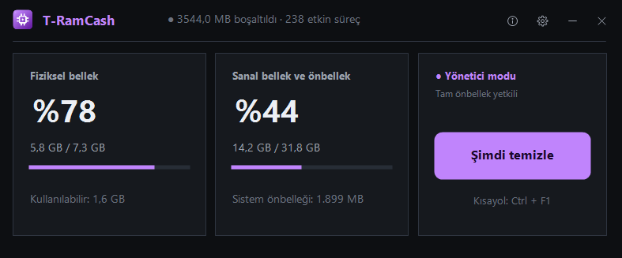

<div align="center">


<h1>T-RamCash</h1>

<p>
  <strong>Windows sistemlerde biriken gereksiz bellek önbelleğini ve çalışma kümelerini yerel NT API'leriyle güvenle temizleyen ultra hafif RAM yöneticisi.</strong>
</p>

<p>
  <a href="https://github.com/taha-sa/t-ramcash-releases/releases/latest">
    
  </a>
  
  
  <a href="https://github.com/taha-sa/t-ramcash-releases/releases">
    
  </a>
</p>

<p>
  <a href="#-öne-çıkan-özellikler">Özellikler</a> •
  <a href="#-5-katmanlı-temizlik-motoru">Temizlik Motoru</a> •
  <a href="#-indir-ve-kur">İndir & Kur</a> •
  <a href="#-gizlilik-ve-güvenlik">Güvenlik</a> •
  <a href="#-t-suite-ekosistemi">T-Suite</a>
</p>

</div>

<p align="center">
  
</p>

> **Not:** Bu depo yalnızca resmi derlenmiş Windows kurulum dosyasını, taşınabilir (portable) sürümü, güncelleyici manifestini ve `SHA-256` doğrulama özetlerini barındırır.

---

## ✨ Öne Çıkan Özellikler

| Özellik | Detay |
|---|---|
| 🧹 **Tek Tıkla Anlık RAM Temizliği** | Oyunlarda, tarayıcı yoğunluğunda veya ağır iş yüklerinde biriken gereksiz bellek önbelleğini saniyeler içinde güvenle boşaltır. |
| 🤖 **Çift Otomatik Temizleme Modu** | **Eşik tabanlı** (örn. RAM kullanımı %85'i geçtiğinde) veya **zamanlayıcı tabanlı** (örn. her 15 dakikada bir) otomatik bellek rahatlatma. |
| 📊 **Canlı Bellek & Tepsi İzleme** | Fiziksel bellek, sanal bellek ve sistem önbelleğini anlık izleyin; özelleştirilebilir **Uyarı (%60)** ve **Tehlike (%80)** renk eşikleriyle sistem tepsisinden takip edin. |
| 🪶 **Tüy Gibi Hafif (~620 KB)** | Arka planda neredeyse hiç CPU ve RAM tüketmeden sessizce çalışır. |
| 🎨 **Esnek Masaüstü Deneyimi** | Koyu/Açık tema, Windows ile otomatik başlama, simge durumunda başlama, "Her Zaman Üstte" modu ve temizlik sonuç bildirimleri. |
| 🔗 **T-Suite & İmzalı Güncelleme** | **T-Bridge Hub** üzerinden uzaktan/tek panelden başlatma ve ECDSA imzalı uygulama içi otomatik güncelleme desteği. |

---

## ⚙️ 5 Katmanlı Temizlik Motoru

T-RamCash, Windows'un yerel `NtSetSystemInformation` ve `PSAPI` sistem çağrılarını kullanarak aşağıdaki 5 bellek alanını ayarlarınız doğrultusunda seçmeli olarak temizler:

1. **İşlem Çalışma Kümeleri** *(Process Working Sets)*
2. **Sistem Çalışma Kümesi** *(System Working Set)*
3. **Değiştirilmiş Sayfa Listesi** *(Modified Page List)*
4. **Bekleme Listesi** *(Standby List)*
5. **Düşük Öncelikli Bekleme Listesi** *(Low-Priority Standby List)*

---

## 📥 İndir ve Kur

### 👉 [En Son Sürümü İndir (Latest Release)](https://github.com/taha-sa/t-ramcash-releases/releases/latest)

| Dosya | Açıklama | Platform |
|---|---|---|
| `T-RamCash-Setup-1.2.0.exe` | Resmi Windows kurulum paketi | Windows 10/11 (x64) |
| `T-RamCash.zip` | Kurulumsuz taşınabilir (Portable) sürüm (~620 KB) | Windows 10/11 (x64) |
| `SHA256SUMS.txt` | Bütünlük doğrulama özetleri | Tümü |

<details>
<summary><strong>📌 Kurulum Notları (Yönetici İzni · SmartScreen · SHA-256)</strong></summary>

<br/>

- **Yönetici İzni (UAC):** Sistem çalışma kümesi ve Standby List temizliği Windows çekirdek ayrıcalığı gerektirdiğinden T-RamCash yönetici yetkisiyle çalışır.
- **Windows SmartScreen:** İlk kurulumda uyarı ekranı çıkarsa **Ek bilgi → Yine de çalıştır** seçeneğini kullanabilirsiniz.

```powershell
Get-FileHash .\T-RamCash-Setup-1.2.0.exe -Algorithm SHA256
# Çıktıyı sürüm sayfasındaki SHA256SUMS.txt ile karşılaştırın.
```

</details>

---

## 💻 Sistem Gereksinimleri

- **İşletim Sistemi:** Windows 10 veya Windows 11 (64-bit)
- **Yetki:** Derin bellek temizliği için Yönetici (Administrator) izni
- **Arayüz Dilleri:** Türkçe (TR) · English (EN) · Deutsch (DE)

---

## 🔒 Gizlilik ve Güvenlik

- **%100 Yerel:** Tüm işlemler yalnızca yerel Windows bellek API'leri üzerinden çalışır.
- **Sıfır Telemetri:** Hiçbir sistem verisi dışarıya gönderilmez; reklam veya izleyici içermez.
- **İmzalı Güncellemeler:** Uygulama içi güncellemeler kriptografik olarak doğrulanır.

---

## 🧩 T-Suite Ekosistemi

| Uygulama | Ne İşe Yarar? | Platform | Sürüm Deposu |
|---|---|---|---|
| **T-Bridge** | Windows & Android arası dosya, pano, bildirim, kumanda ve T-Suite Hub | Windows, Android | [taha-sa/t-bridge-releases](https://github.com/taha-sa/t-bridge-releases) |
| **T-Downloader** | Çok parçacıklı indirme yöneticisi + video/HLS + tarayıcı eklentisi | Windows, Chrome/Edge/Brave | [taha-sa/t-downloader-releases](https://github.com/taha-sa/t-downloader-releases) |
| **T-DeskTree** | NTFS MFT ultra hızlı disk & klasör analizi + Treemap | Windows | [taha-sa/t-desktree-releases](https://github.com/taha-sa/t-desktree-releases) |
| **T-RamCash** *(bu depo)* | 5 katmanlı RAM temizleyici ve canlı sistem tepsisi izleyici | Windows | [taha-sa/t-ramcash-releases](https://github.com/taha-sa/t-ramcash-releases) |
| **T-Desk Viewer** | PDF, Office, EPUB, Kod & ZIP mobil belge görüntüleyici | Android | [taha-sa/tdesk-viewer-releases](https://github.com/taha-sa/tdesk-viewer-releases) |

<details>
<summary><strong>🇬🇧 English Summary</strong></summary>

<br/>

**T-RamCash** is an ultra-lightweight (~620 KB portable) Windows RAM cleaner and real-time tray monitor powered by native Windows NT memory APIs. Features selective 5-layer memory cleaning (Working Sets, System Working Set, Modified Page List, Standby & Low-Priority Standby Lists), threshold and interval auto-clean, dark/light themes, signed updates, and zero telemetry in Turkish, English, and German.

</details>

---

<p align="center">
  Hata bildirimi veya özellik önerisi için <a href="https://github.com/taha-sa/t-ramcash-releases/issues">Issues</a> sekmesini kullanabilirsiniz · <a href="https://github.com/taha-sa">T-Suite Ekosistemi</a>
</p>